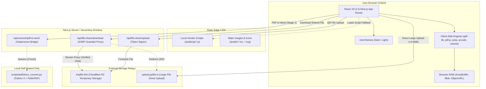
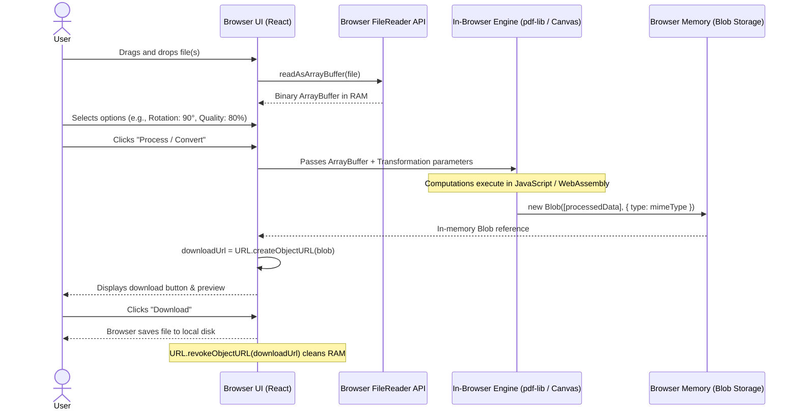
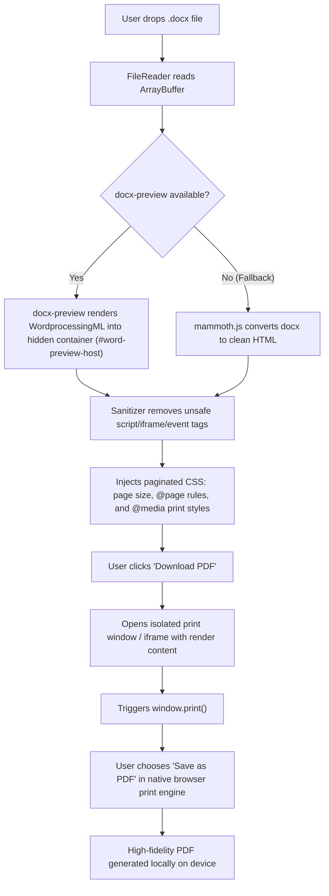
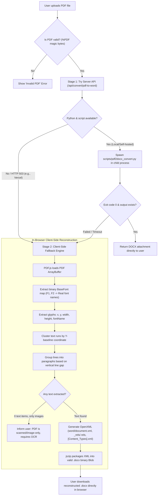
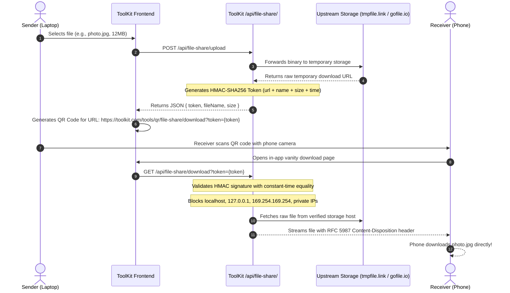

# 04. Architecture and Data Flow — ToolKit

This document explains the technical architecture of ToolKit, illustrating how user inputs, files, and state travel through the application with **Mermaid sequence and flow diagrams**.

---

## 1. High-Level System Architecture

ToolKit uses a **Hybrid Edge Architecture**. 95% of features execute strictly within the user's web browser, while serverless API routes handle external storage relaying and optional backend conversions:

---

## 2. Data Flow 1: 100% Client-Side In-Memory Tools

*(Applies to: Merge PDF, Split PDF, Rotate PDF, Reorder PDF, Compress Image, Resize Image, Convert Image, Scientific Calculator, Unit Converter, Hash Generator, etc.)*

In these tools, data never leaves the user's browser. Memory is allocated in RAM and automatically freed when completed:

---

## 3. Data Flow 2: Word to PDF Conversion Pipeline

Converting Microsoft Word documents to PDF in the browser without third-party server uploads requires a creative, high-fidelity browser pipeline:

---

## 4. Data Flow 3: Dual-Engine PDF to Word Pipeline

PDF-to-Word is one of the most mathematically complex conversions because PDFs store text glyphs with absolute X,Y coordinates rather than semantic paragraphs or words. ToolKit uses a **Dual-Engine Architecture**:

---

## 5. Data Flow 4: File Share QR Pipeline (End-to-End)

When a user wants to transfer a file (up to 100MB) from their laptop to their smartphone:

---

## 6. Memory Safety & Garbage Collection

Because heavy client-side processing can consume significant RAM (e.g., merging ten 15MB PDFs), ToolKit strictly enforces memory hygiene:

1. **Explicit Object URL Revocation**: Whenever a new download URL is generated (`URL.createObjectURL(blob)`), any previously existing URL is immediately revoked using `URL.revokeObjectURL(oldUrl)`. This signals to the browser garbage collector that the old Blob can be freed.
2. **Buffer Lifecycle**: ArrayBuffers are loaded inside local function scopes rather than stored in global state. Once the output document is assembled, the input buffers fall out of scope and are collected.
3. **Canvas Cleanup**: In image conversion and QR scanning, `<canvas>` dimensions and contexts are cleared before new operations.
